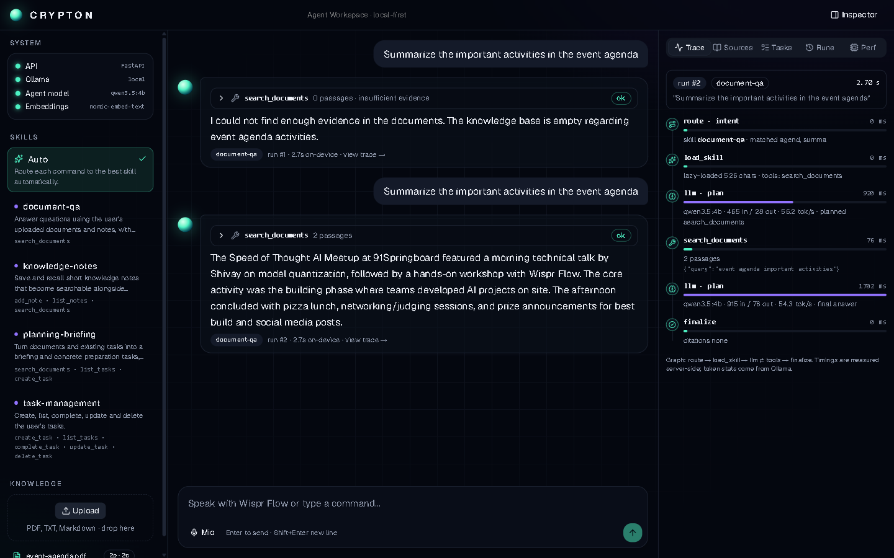

# Crypton Lite

**A private AI assistant that runs on your own laptop and listens to your voice.**
Built for **CRYPTON: Speed of Thought** (WeMakeDevs, 31 Oct 2026).

Say "Create preparation tasks based on the event agenda document" and a small local model reads your PDF, creates the tasks, and answers with citations that point to the exact page. Say "Open calculator" and it opens it. Ask "best laptop under 50k" and it researches the live web. Your documents, tasks and database never leave the machine.



## Why it exists
People capture tasks while their hands are busy, and cloud assistants send private documents away. Crypton Lite keeps the model, retrieval, tools and storage local (a 4-bit 4B model fits a 6 GB GPU), and uses the network only for voice transcription (Wispr Flow) and live web research (Anakin.io).

## What you can say

| Say or type | What happens |
|---|---|
| "Create preparation tasks based on the event agenda document" | Reads the uploaded agenda, creates tasks with due dates, cites page numbers |
| "Add a task: charge my laptop" / "Delete the charger task" | Task changes; deletes always ask for a Confirm click |
| "Remember: the demo charger is in the blue bag" | Saves a searchable note |
| "Open calculator" / "Open my downloads folder" / "Open YouTube" | Opens an app, folder or website from a fixed safe list |
| "Best laptop under 50k" | Live web search (Anakin.io) with sources and prices |
| "Scrape https://example.com and tell me what it says" | Reads the page text (Anakin.io) |

The default screen is deliberately simple: a chat box and a to-do list. Click **Advanced** for the timeline, sources, skills and performance panels.

## Wispr Flow, Anakin.io and GenieX: what each one did

| Tool | Role in this build | Status |
|---|---|---|
| **Wispr Flow** | Voice input. Hold the Wispr key in the message box and speak; Wispr types the text, Enter starts the agent. Wispr only transcribes; it does not run tools. | Supported by design (no code needed: it types into the focused box). Setup and tips: [docs/WISPR_FLOW_WORKSHOP.md](docs/WISPR_FLOW_WORKSHOP.md) |
| **Anakin.io** | The `web-research` skill: `web_search` (AI web search) and `scrape_url` (page text), in `backend/anakin.py`. | Verified live (search and scrape) with a real key; mocked tests cover errors |
| **GenieX** | Not run. It needs Snapdragon hardware and this build ran on Intel + NVIDIA. | Not verified |

Full write-up: [SUBMISSION.md](SUBMISSION.md).

## How it works
```
voice/text -> route skill -> local LLM (Ollama) -> validated tool call -> result -> reply + trace
                 |                                   |
        skills/*/SKILL.md          tasks (SQLite) · documents (ChromaDB) · web (Anakin) · computer (allowlist)
```
- **Skills** (`skills/*/SKILL.md`) are loaded lazily; the router picks one by keywords with no extra model call, so only that skill's tools are in the prompt.
- **Tools** (`backend/tools.py`) are an allowlist with Pydantic-validated arguments. Failures are reported honestly and never retried blindly; repeated task creations are de-duplicated.
- **RAG** (`backend/rag.py`): PDF/text chunks embedded with `nomic-embed-text`, retrieved with a relevance threshold, and answered with `[1]`, `[2]` citations. If evidence is weak, the agent says so instead of inventing.
- **Trace**: every request records route, skill, model and tool steps with real millisecond timings.

More: [docs/ARCHITECTURE.md](docs/ARCHITECTURE.md), [docs/MODEL_QUANTIZATION.md](docs/MODEL_QUANTIZATION.md), [docs/SKILL_WORKFLOW.md](docs/SKILL_WORKFLOW.md).

## Safety
- **Computer control is not a shell.** The model can only choose a name from a fixed list of apps and folders (or give an `http(s)` URL). Nothing it writes is executed as a command. See `backend/system.py`.
- Run the server on **localhost only** (`--host 127.0.0.1`). Anyone who can reach the server can ask it to open apps on your computer.
- Delete actions require an explicit Confirm click.
- Secrets live in a gitignored `.env`, never in the repo.

## Quick start (Windows)
Requirements: Python 3.11+, [Ollama](https://ollama.com). Node is only needed to rebuild the frontend.

```powershell
git clone https://github.com/Cod4Nitish/crypton-lite
cd crypton-lite
python -m venv .venv
.venv\Scripts\pip install -r requirements.txt
ollama pull qwen3.5:4b
ollama pull nomic-embed-text
copy .env.example .env        # then put your Anakin key after ANAKIN_API_KEY=
.venv\Scripts\python -m uvicorn backend.main:app --host 127.0.0.1 --port 8000
```
Open http://localhost:8000 and click **Advanced -> Prepare demo (sample data)** to load a sample agenda and tasks. Send "list my tasks" once to warm the model (the first reply takes a few seconds).

Get an Anakin key at [anakin.io](https://anakin.io). Without one, the agent still does everything except web search, and tells you so.

Install it as an app: in Chrome or Edge click the install icon in the address bar. The built UI is committed in `web/dist`, so Node is not required. To rebuild: `cd web && npm install && npm run build`.

## Tests
```powershell
.venv\Scripts\python -m pytest -q
```
62 tests pass offline; the `test_live_*` files also need Ollama running.

## Project layout
| Path | Purpose |
|---|---|
| `backend/` | FastAPI app, agent loop (LangGraph), tools, RAG, Anakin client, computer control, SQLite |
| `web/` | React + TypeScript UI (Vite); built output in `web/dist` |
| `frontend/` | Original no-build UI, served at `/lite`, plus PWA manifest and service worker |
| `skills/` | Agent skills: task-management, document-qa, planning-briefing, knowledge-notes, web-research, computer-control |
| `benchmarks/` | Quantization benchmark script and real results |
| `docs/` | Architecture, quantization, skill workflow, Wispr Flow notes, presentation plan |
| `tests/` | Offline and live tests |

Known limits and honest status: [PROJECT_STATUS.md](PROJECT_STATUS.md). Demo script: [EVENT_RUNBOOK.md](EVENT_RUNBOOK.md) and [docs/PRESENTATION.md](docs/PRESENTATION.md).

## Contributing
1. Create a branch: `git checkout -b feature/your-change`
2. Run the tests.
3. Open a pull request into `main`.
